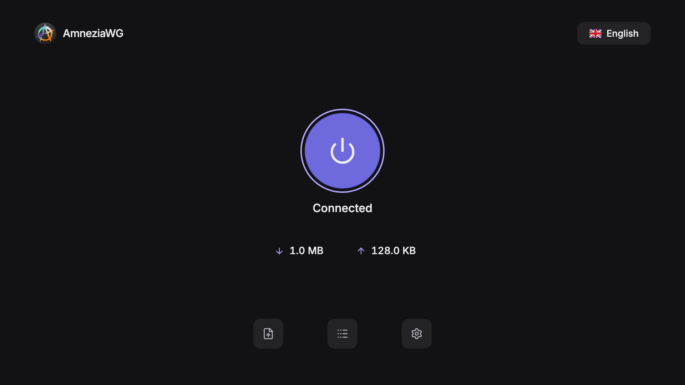

# webos-amneziawg

AmneziaWG VPN client for rooted LG webOS TVs. Includes a remote-friendly interface in English and Russian, LAN configuration import, startup autoconnect, traffic counters and logs.

The VPN runs in the background when the app is closed. IPv4 routing lists let you send selected destinations through the VPN or connect to them directly.



## Requirements

- A rooted LG webOS TV with Homebrew Channel's root service enabled.
- ARMv7 execution support and `/dev/net/tun`.
- An AmneziaWG configuration with one peer, an IPv4 address and `AllowedIPs` including `0.0.0.0/0`.

Verified on an LG 55UN81006LB running webOS 5.6.2. Other models and firmware versions may differ. The bundled AmneziaWG 3.1 binaries are statically linked; no kernel module or additional runtime libraries are required.

## Install

Download `webos-amneziawg_0.1.1_all.ipk` from [Releases](https://github.com/dikuchan/webos-amneziawg/releases). You do not need Go, Bun or Docker to use the app.

Replace `TV_IP` with your TV's LAN address. From your computer, in the directory containing the downloaded package:

```sh
scp -O webos-amneziawg_0.1.1_all.ipk root@TV_IP:/tmp/amneziawg.ipk
ssh root@TV_IP
```

In the TV's SSH shell:

```sh
luna-send -i -f luna://com.webos.appInstallService/dev/install \
  '{"id":"com.github.dikuchan.amneziawg","ipkUrl":"/tmp/amneziawg.ipk","subscribe":true}'
```

Wait for `"statusValue": 30`, then press Ctrl+C and open **AmneziaWG** from the launcher. See the [Homebrew Channel installer](https://github.com/webosbrew/webos-homebrew-channel/blob/main/services/service.ts) for installation status codes.

For updates, disconnect the VPN and close the app before installing the new IPK. The saved profile and settings are retained.

## Connect

1. Open **Configuration** on the TV.
2. On a phone or computer on the same LAN, open the displayed address and enter the code shown on the TV. Keep the TV's web settings panel open while using the page.
3. Upload your provider's `.conf` file, then connect using the power button on the TV.

Disconnect before replacing a VPN profile. Web settings use HTTP on the local network and close when you leave the TV panel or after ten minutes.

Enable **Settings → Connect on device startup** for automatic connection. Disable autoconnect in any other VPN client first; an active ordinary WireGuard connection must also be stopped before connecting.

Use the language button in the top-right corner of the home screen to switch between English and Russian. The app follows the TV language until you make a selection, and uses English for other locales.

## Routing

Open **Settings → Routing** to select a mode:

| Mode | Listed IPv4 destinations | Other IPv4 destinations |
| --- | --- | --- |
| All traffic | VPN | VPN |
| Exclude lists | Direct | VPN |
| Only lists | VPN | Direct |

Choose **Edit lists**, open web settings on another device, and select its **Routing** tab. Sources can be local TXT files, HTTPS TXT URLs, or the bundled [RU Direct Standard](https://github.com/kyoresuas/ru-direct) preset. All sources are merged into one list.

Use UTF-8 text with one IPv4 address or CIDR per line:

```text
# Example format; replace with your destinations
203.0.113.0/24
198.51.100.7
```

Blank lines and `#` comments are allowed. Domains, IPv6 and binary `.dat` lists are not supported. Limits are 8 sources, 256 KiB per source, 1 MiB combined and 16384 normalized subnets.

Each HTTPS source has an update interval of 1–168 hours, defaulting to 24. An optional SHA-256 URL can provide a plain hash or a matching `sha256sum` entry. Use the final HTTPS URL; redirects are not followed.

Updates run while the VPN is connected, including when the app is closed. Failed downloads or checksum checks retain the last valid list and retry after an hour. Saving settings or refreshing lists changes routes without reconnecting the VPN.

Connected LAN networks and the VPN endpoint remain direct. DNS servers from the profile stay routed through the tunnel. Physical-interface IPv6 is disabled while connected and restored on disconnect. These are destination-IP rules, not per-app or domain rules; services outside the lists may take a different path than expected.

## CLI and troubleshooting

In the TV's SSH shell:

```sh
AWG=/media/developer/apps/usr/palm/applications/com.github.dikuchan.amneziawg/payload/bin/amneziawgctl
"$AWG" status
"$AWG" logs
"$AWG" start
"$AWG" stop
```

If network recovery is required, keep the state directory and run `stop` again. Disconnect and disable autoconnect before uninstalling. State is stored in `/var/lib/webosbrew/amneziawg`.

There is no kill switch or continuous reconnection supervisor. Connected status checks the daemon and whether a handshake has occurred; it does not guarantee current Internet reachability.

The `webos-amneziawg-0.1.1-armv7.tar.gz` release archive is an alternative for SSH-only use. Upload it to the TV, extract it into `/var/lib/webosbrew/amneziawg`, and use `bin/amneziawgctl` there. Import a profile with `"$AWG" import /path/to/profile.conf` after setting `AWG` to that binary. Choose either this installation or the IPK.

## Development and licenses

See [BUILDING.md](BUILDING.md) for source builds, checks and release packaging. The IPK's `_all` suffix describes the web app package; its native payload is ARMv7.

Based on [webos-wireguard](https://github.com/RodriguezCF/webos-wireguard), with [amneziawg-go](https://github.com/amnezia-vpn/amneziawg-go) and [amneziawg-tools](https://github.com/amnezia-vpn/amneziawg-tools). Application code is MIT-licensed; dependencies and assets retain their own licenses, included in release packages. Asset sources are listed in [web/assets/README.md](web/assets/README.md).

This is an independent project, not an official Amnezia application.
